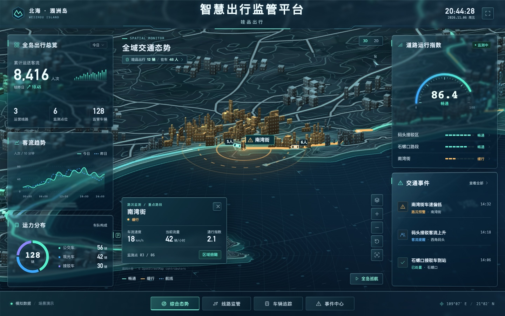

# 智慧出行监管平台 · 哇品出行

涠洲岛智慧交通监管大屏的离线二次开发工程。此包交付的是 2026-11-06 的玻璃面板版，包含现成大屏、前端源码、演示数据、地理素材和重建工具。

**直接演示**：先解压整个 ZIP，再用桌面浏览器打开 [dist/index.html](dist/index.html)。地图、车辆、图表和建筑全部嵌入页面，打开后即可断网使用。在首页点击车辆，或从底栏进入「车辆追踪」，可以看到始发站、终点站、已行轨迹、待行路线及实载人数。

**交给其他智能体修改**：让它打开解压后的整个 `weizhou-mobility` 文件夹，先读 [AGENTS.md](AGENTS.md)，再告诉它具体想改什么。如果智能体接受 ZIP 附件，可以直接给它完整压缩包。



## 修改后重新生成大屏

用编辑器或智能体修改 `src/` 中的文件，然后在本目录运行下列命令。日常构建只使用 Python 3 标准库，可在离线环境运行。

**macOS / Linux**

```sh
python3 build.py
```

**Windows（已安装 Python 3）**

```powershell
py -3 build.py
```

脚本会生成 `dist/index.html`。重新打开或刷新这一文件即可查看修改。分享演示成品时可单独发送它；交付给下一位开发者时请发送整个工程。需要通过 HTTP 预览时，也可以在项目根目录运行 `python3 -m http.server 8000 --bind 127.0.0.1 --directory dist` 并在本机打开 `http://127.0.0.1:8000`。

## 常见修改从哪里入手

| 想修改的内容 | 先打开这些文件 |
| --- | --- |
| 平台名称、副标题、页头布局 | `src/base.html` |
| 玻璃面板透明度、模糊强度、透视和边缘高光 | `src/css/glass.css`。面板底色在 `--panel`，桌面背景层另有 `.rail > .panel::after` 规则 |
| 站点名称、线路站序、演示事件 | `src/js/data.js`；地理位置对应 `src/js/map.js` 的 `xy` |
| 左右侧面板、客流数字与图表 | `src/js/panels.js` 和 `src/js/charts.js` |
| 车辆数量、载客分布、上下客、停靠及运行速度 | `src/js/fleet-engine.js`；正常演示单车上限为 7 名乘客 |
| 车标、轨迹、跟随、播放倍速及单车详情 | `src/js/fleet-map.js`、`fleet-screen.js`、`fleet-ui.js`，样式在 `src/css/fleet-*.css` |
| 地形、道路与建筑 | `src/assets/island.svg`、`src/assets/buildings.json`、`src/js/city.js`。需要从地理原料重绘时查看 `tools/geo/` |

## 运行和验收

浏览器使用 WebGL 绘制三维建筑，未启用 WebGL 时可查看内嵌的矢量建筑。客流指标、车辆行程、建筑高度和告警均服务于演示。车队模拟有 3 条线路、12 辆车；界面上的全岛汇总和线路整体运力是独立的演示口径。事件处置状态由当前浏览器本地保存。

若设备已安装 Node.js 20 或更高版本，可在根目录执行下列可选测试。它直接读取包内三条地图路线，验证车队数量、七人上限、停靠和行驶时的位置与轨迹。运行测试无需安装 npm 依赖。

```sh
node --test tests/fleet.test.cjs
```

日常开发可以直接编辑随包附带的 SVG 和建筑 JSON。高级地理重建工具另有 Python 扩展库要求，所需的地理数据和来源说明已放在 `tools/geo/`。

